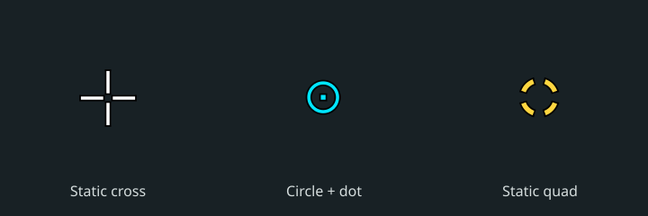
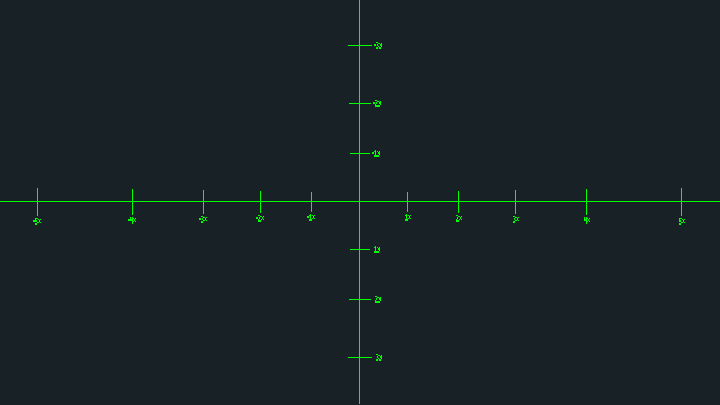
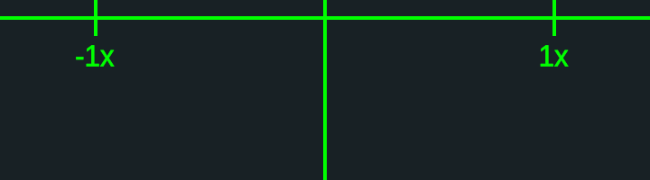

# @setposgg/cs2-crosshair

CS2 crosshair share codes and drawing, plus the grenade line-up reticle. Framework-free
TypeScript, ESM, no runtime dependencies. The geometry is an exact port of CS2's crosshair
from 2026-09-23 and its share-code format from 2026-10-01, checked against the 2026-10-08
client. The reticle follows the 2026-10-05 client.



Used on [setpos.gg](https://setpos.gg): a player pastes their code in settings and every
lineup video shows their crosshair. This package owns that code; setpos imports it.

## Install

```sh
npm install @setposgg/cs2-crosshair
```

Node 22.18+ for the development scripts and tests; the compiled ESM also runs in modern
browsers. No framework, DOM or canvas is needed to decode codes or compute drawings.

## Read a code and draw it

```ts
import {
	crosshairCodeKind,
	decodeCrosshair,
	encodeCrosshair,
	crosshairDrawing,
	crosshairBounds,
	fitCrosshair
} from '@setposgg/cs2-crosshair';
import { crosshairToSvg, crosshairToCanvas } from '@setposgg/cs2-crosshair/renderers';

const code = 'CSyAqUtN69wWNvDFi89hfa9qHCnj5JURoPsvD99oC8V6wL';
crosshairCodeKind(code); // 'current', 'old' (CSGO-...), or 'invalid'
const crosshair = decodeCrosshair(code); // Crosshair | null
if (crosshair) {
	encodeCrosshair(crosshair); // round trip
	fitCrosshair(crosshair, 1440); // sizes fitted to a different screen height
	const frame = { width: 1920, height: 1080 };
	const drawing = crosshairDrawing(crosshair, frame); // fits automatically
	crosshairBounds(drawing); // { left, top, right, bottom }, outline included; or null
	const svg = crosshairToSvg(drawing, frame); // complete SVG string
	// crosshairToCanvas(context, drawing); // an existing Canvas 2D context
}
```

`CrosshairDrawing` contains rectangles, rings and four-part arcs, their colours, and outline
reach. Rectangles use whole frame pixels; odd-width circles sit on half-pixel centres.
Draw at the frame's size to preserve those pixels. Both optional renderers share the same
layers, outline rules and opacity: overlapping bars do not become darker. Canvas drawing
preserves the caller's state, multiplies its opacity, and leaves existing pixels in place.
Rasterized circle edges can vary between renderers; this is geometry, not a port of the game's
pixel shader. Dynamic styles are shown standing still with a grenade in hand, without recoil
or weapon inaccuracy. Old `CSGO-` codes are classified but not decoded.

For an existing SVG, `crosshairToSvgContent(drawing)` returns its children. For a custom
renderer, use `crosshairLayers(drawing)` and `layersToSvgContent`, `layersToSvg`, or
`layersToCanvas`. `DEFAULT_CROSSHAIR`, `SITE_CROSSHAIR` (setpos's white cross), and the
numbered `CROSSHAIR_STYLES` names are exported from the main entry point.

## Grenade reticle





```ts
import { grenadeReticle } from '@setposgg/cs2-crosshair';
import { reticleToSvg, reticleToCanvas } from '@setposgg/cs2-crosshair/renderers';

const frame = { width: 1920, height: 1080 };
const reticle = grenadeReticle({ ...frame, fov: 90 });
const svg = reticleToSvg(reticle, frame, { color: [0, 255, 0, 255] });
// reticleToCanvas(context, reticle); // same drawing, green by default
```

FOV is Source's horizontal FOV for a 4:3 frame. Width and height must be positive whole pixels;
FOV must be finite and between 0 and 180. Ticks project in ten-degree steps and remain on the
same directions at other FOVs and aspect ratios. `reticleFocal(height, fov)` exposes the focal
length. `grenadeReticle` returns `rects` and `glyphs` (text, label box and original atlas-cell
indices). `{ labels: false }` omits the label boxes.

The game draws these labels from a texture of Arial at 40 px. Default labels here use embedded
outlines from Liberation Sans Regular 2.1.5, a metrically compatible Arial substitute, slightly
thickened to match, under the [SIL Open Font License](THIRD_PARTY_NOTICES.md). Only the characters
`-0123456789xy` are included; no installed font is needed. The game's numeral texture stays
outside the package. Cell size, label boxes and placement match the game; native SVG/Canvas
antialiasing approximates its texture filtering. Letter shapes and edge pixels differ.

`reticleLabelPaths(glyphs)` exposes the outlines in frame coordinates. `reticleLabelRects(glyphs)`
is a monochrome fallback for rectangle-only clients. Pass `{ labels: () => [] }` to hide labels,
or supply your own rectangle callback. `reticleLayers` exposes the shared renderer layers.
The caller handles pin-pull delay, fade-in, and whether to keep the regular crosshair visible.

Supply your own image with `reticleToSvg(reticle, frame, { atlas: { href, width, height, cellWidth, cellHeight } })`, or use `reticleAtlasToSvgContent(glyphs, atlas)` inside your SVG (an optional `filter` tints the image).

## Development

```sh
npm ci
npm test          # builds, then node --test against the compiled public entry points
npm run build    # tsc: dist/*.js and dist/*.d.ts
npm run examples # regenerate the pictures above, using this package's renderer
npm pack --dry-run
```

The ported tests pin the existing share codes and pixel coordinates. See the
[crosshair notes](docs/crosshair.md) and [reticle notes](docs/grenade-reticle.md) for the byte
layout, rounding, projection and game-update checks.

Code: MIT. Embedded glyph outlines: SIL OFL 1.1; see [third-party notices](THIRD_PARTY_NOTICES.md).

Built for [setpos.gg](https://setpos.gg). Links back are welcome.

Counter-Strike 2 is a trademark of Valve Corporation. Not affiliated with Valve.
